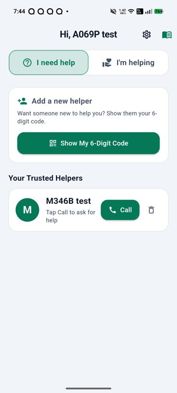
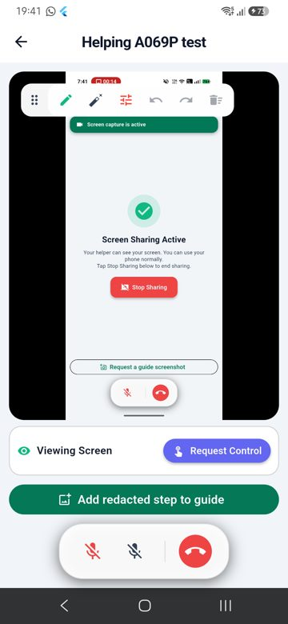
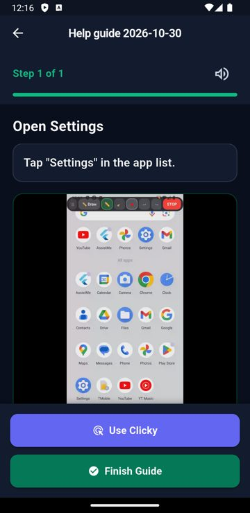
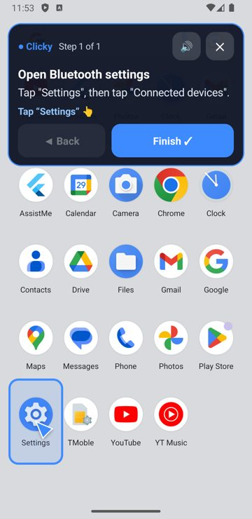
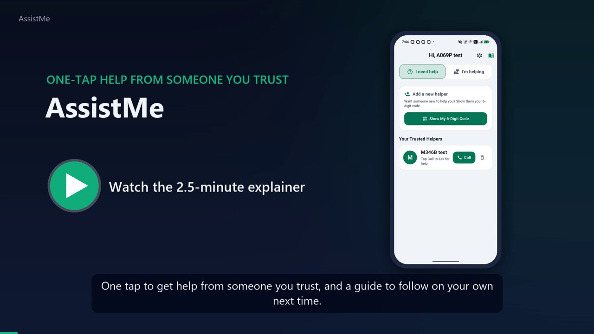
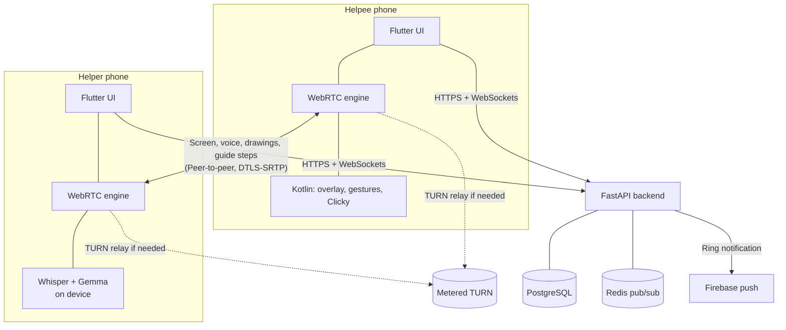

# AssistMe

**One-tap remote help for the people who need it most, and a guide they can follow on their own next time.**

AssistMe connects an older adult (the *helpee*) with a trusted family member or friend (the *helper*). The helpee taps one button and the helper's phone rings. The helper then sees the helpee's screen live, talks them through the problem, and draws on their screen to point the way. If the helpee allows it, the helper can also tap for them.

When the call ends, the helpee keeps an encrypted step-by-step guide: screenshots the helper reviewed, with steps written on the helper's phone from what was said during the call. Next time the same problem comes up, **Clicky** replays the guide on the helpee's own phone, fully offline. It reads each step aloud and points at the button to press.

<p align="center">
  
  
  
  
</p>

<p align="center">
  <a href="docs/media/assistme-explainer.mp4">
    
  </a>
  <br>
  <sub><a href="docs/media/assistme-explainer.mp4">Watch the 2.5-minute explainer</a> · <a href="https://github.com/FalconFuryX77/AssistMe/releases/latest">Download the Android app</a></sub>
</p>

---

## Why AssistMe

Most remote-support tools are built for IT desks: they need accounts, session codes, and someone who knows what "allow screen recording" means. AssistMe is built for the people on the other end of the phone call:

- **Nothing to remember.** No email, password or meeting code. The phone itself is the identity, and a helper is added once with a 6-digit code.
- **One tap to get help.** The helpee taps a trusted person; their phone rings, even when the app is closed.
- **Watching first, control only with consent.** Helpers see and draw by default. Touch control needs the helpee's explicit approval after a risk warning, and the helpee can always reach STOP.
- **Help that lasts after the call.** Every session can leave behind a private guide, and Clicky turns it into hands-on, offline guidance.
- **Private by design.** Screen, voice and drawings travel phone to phone. Guides are encrypted on the device, and the AI that writes them runs on the helper's phone. The server never sees screenshots, audio or guide text.

## Features

| | What it does |
| --- | --- |
| **Trusted pairing** | The helpee shows a 6-digit code, the helper types it and the helpee approves. Device-first accounts come with a one-time recovery code. |
| **One-tap calls** | Calls ring over a persistent device channel plus Firebase push, with missed-call recovery. |
| **Live screen and voice** | WebRTC screen sharing (30 fps, up to 2.5 Mbps) with two-way voice. Phones connect directly or through a TURN relay across different networks. |
| **Annotations** | Helper strokes appear on top of any app on the helpee's phone, including above the notification shade. Live previews arrive within about 32 ms batches over an unreliable data channel, and committed strokes over a reliable one. |
| **Consent-based remote control** | Taps, drags, long presses and key events are injected through Android's accessibility service. Password, banking and permission screens are detected, and the helpee's STOP control can't be pressed by the helper. |
| **Guide capture** | One tap captures a step during the call, with nothing to type. After the call the helper reviews each screenshot in turn, covering private details with solid blocks or tapping **Skip all**, and the steps are written from the transcript. |
| **On-device AI** | Whisper tiny turns the call into a transcript (only with the helpee's consent) and Gemma 4 E2B drafts the steps. Both run locally through LiteRT; models download once, on request. |
| **Encrypted guide delivery** | Guides are delivered live over the call's data channel, or later as AES-GCM ciphertext the server can't read. |
| **Clicky** | An offline walkthrough over any app: a floating card speaks each step and a pointer flies to the control to tap. It handles press-and-hold and swipe steps, accepts "Done" where a guide says "Next", skips ahead when you're already there, and **Back** takes the phone back to the earlier step's screen. |
| **Resilient calls** | Calls survive Wi-Fi to mobile-data switches, dropped sockets, multi-worker backends and app restarts. |

## How it works



1. **Pair once.** `POST /devices/pairing/setup-code`, then `/claim`, then `/approve`.
2. **Ring.** `POST /help/call` creates or reuses the pair's session and pushes `incoming_call` through Redis to whichever backend worker holds the helper's socket, plus an FCM push.
3. **Signal.** Both phones join `/ws/session/{id}`. The helpee is always the WebRTC offerer. Offers for a peer that isn't connected yet are parked in Redis and replayed when it joins.
4. **Connect.** ICE tries direct paths first (STUN), then a Metered TURN relay. Media and data then flow phone to phone.
5. **Guide.** Screenshots stay on the helper's phone until they are reviewed after the call; then the guide and its screenshots go over the data channel. If the helpee has already hung up, the guide is uploaded encrypted and collected later.

A file-by-file walkthrough of every feature is in [`docs/CODEBASE_GUIDE.md`](docs/CODEBASE_GUIDE.md).

## Privacy and security

- **No accounts.** Device-bound identity, JWT access tokens, and Argon2id-hashed recovery codes.
- **Encrypted at rest.** Sensitive database columns use AES-256-GCM envelope encryption with blind indexes for lookups. On the phone, guides use AES-256-GCM with a key in Android Keystore-backed storage.
- **End-to-end media.** WebRTC media and data are DTLS-SRTP encrypted between the phones.
- **The AI stays local.** Screenshots, audio and guide text never reach AssistMe servers or a hosted model. Call audio is recorded only after the helpee agrees, lasts at most 20 minutes, and is deleted after transcription.
- **Redaction is permanent.** Covered pixels are replaced with solid blocks before a screenshot is saved or shown to the model.
- **The helpee stays in charge.** Control is opt-in and revocable, private screens are detected, and STOP is always within the helpee's reach.

See the [threat model](docs/threat_model.md), [permission model](docs/permission_model.md) and [cryptography design](docs/CRYPTOGRAPHY_DESIGN.md).

## Tech stack

| Area | Technology |
| --- | --- |
| Mobile | Flutter 3.47 (Dart), Kotlin for Android-native features |
| Real-time media | `flutter_webrtc` 1.6, Android MediaProjection, AccessibilityService |
| On-device AI | `flutter_edge_ai` with LiteRT-LM (Gemma 4 E2B) and LiteRT speech (Whisper tiny) |
| Backend | Python, FastAPI, uvicorn (4 workers), SQLAlchemy (async), Alembic |
| Data | PostgreSQL 16, Redis 7 |
| Connectivity | Google STUN, Metered TURN, Firebase Cloud Messaging |
| Deployment | Docker Compose, nginx, Cloudflare Tunnel, Kubernetes manifests |

## Repository layout

```
backend/   FastAPI app: routers, services, models, migrations, crypto, Redis bus, tests
mobile/    Flutter app: lib/features (screens), lib/core (services), android/ (Kotlin native layer)
deploy/    Docker Compose, nginx, Kubernetes, coturn (optional)
docs/      Architecture, API, database, threat model, crypto, deployment, Clicky, bug log, explainer video
scripts/   Test and screenshot automation helpers; scripts/windows has local run helpers
```

## Try it

Download the latest APK from [Releases](https://github.com/FalconFuryX77/AssistMe/releases/latest) and install it on two Android phones (Android 11 or later). Both phones need to reach an AssistMe backend: the release build points at the author's demo server, which is only online during demos, so for your own use run the backend below and set its address under **Settings → Custom Backend Server** on each phone.

## Getting started

### Requirements

- Docker (for the backend stack), or Python 3.11+ for a local backend
- Flutter 3.47+ and the Android SDK
- Two Android phones running Android 11 or later. On-device AI needs a 64-bit ARM phone with enough RAM; the app checks before downloading anything.

### Backend

```bash
cp deploy/.env.example deploy/.env      # replace every secret with your own
cd deploy
# docker-compose.local.yml publishes the API on port 8000 for LAN testing;
# the production file keeps it behind nginx and the tunnel.
docker compose -f docker-compose.yml -f docker-compose.local.yml up -d --build
docker compose -f docker-compose.yml run --rm migrate
curl http://localhost:8000/health
```

Optional settings:

- `METERED_API_KEY`: TURN relay for phones on different networks. Without it, calls work on the same network or where STUN is enough.
- `backend/firebase-service-account.json`: push rings when the app is closed. It's git-ignored and mounted read-only.

For a local backend without Docker:

```bash
cd backend
python -m venv .venv && . .venv/bin/activate
pip install -r requirements.txt
uvicorn app:app --reload          # SQLite by default
```

Phones need to reach the backend over HTTPS. For a quick demo, a tunnel such as ngrok or Cloudflare Tunnel in front of port 8000 works. See [`docs/CLOUD_DEPLOYMENT.md`](docs/CLOUD_DEPLOYMENT.md) for a permanent setup.

### Mobile app

```bash
cd mobile
flutter pub get
flutter build apk --release --dart-define=DEFAULT_SERVER_URL=https://your-backend.example.com
adb install -r build/app/outputs/flutter-apk/app-release.apk
```

On each phone, open AssistMe and pick a name. Then turn on the **AssistMe accessibility service** (needed for remote control, Clicky, and drawing above the notification shade). To get the AI on the helper's phone, go to **Settings → On-device guide AI → Download models** (about 2.75 GB).

### Tests

```bash
cd backend && python -m pytest -q                                  # API, signaling, crypto, sessions
cd mobile  && flutter analyze && flutter test                      # Dart unit and widget tests
cd mobile/android && ./gradlew :app:testReleaseUnitTest            # Clicky matcher (JVM)
```

## Demo

[**Watch the explainer**](docs/media/assistme-explainer.mp4) (2.5 minutes, narrated): what AssistMe is for, pairing and one-tap calls, live screen sharing with drawing, consent-based control, private guides written by on-device AI, and replaying them offline with Clicky.

## Project status

**Current release: v1.2.0.** AssistMe was built as a capstone project and tested end to end on real Android phones (ASUS, Samsung and OPPO, all on Android 13 or later), on the same Wi-Fi, across networks through TURN, and through Wi-Fi to mobile-data switches.

Known limits:

- Android only; the iOS code paths are not maintained.
- On-device AI needs a 64-bit ARM phone with several GB of RAM. Gemma's drafts are a starting point, so review them before saving.
- Clicky finds controls by their on-screen labels. Icons with no label, and screens that differ a lot from the guide, still need a tap on **Next**.
- The backend also contains research modules (adaptive policy engine, ML risk models, audit ledger) that the current app doesn't use. They are mounted under `/internal` or not mounted at all.

Bugs found during testing and their fixes are logged in [`docs/BUGS.md`](docs/BUGS.md).

## Documentation

| Doc | Covers |
| --- | --- |
| [Codebase guide](docs/CODEBASE_GUIDE.md) | Every file, the feature it implements, and the main flows |
| [Architecture notes](docs/ARCHITECTURE_NOTES.md) | The research framework behind the design |
| [API specification](docs/api_specification.md) | REST and WebSocket endpoints |
| [Database design](docs/DATABASE_DESIGN.md), [schema](docs/database_schema.md) | Tables, constraints, encryption |
| [Threat model](docs/threat_model.md), [permission model](docs/permission_model.md) | What we defend against, and who can do what |
| [Cryptography design](docs/CRYPTOGRAPHY_DESIGN.md) | Field encryption, key rotation, hashing |
| [Clicky integration](docs/CLICKY_INTEGRATION.md) | How the offline walkthrough works |
| [Cloud deployment](docs/CLOUD_DEPLOYMENT.md) | Running the backend publicly |
| [Product vision](VISION.md) | The original product vision and flows |
| [Bug log](docs/BUGS.md) | Every bug found on real phones, its cause and its fix |
| [Archive](docs/archive/) | Earlier plans and roadmaps, kept for history |

## License

AssistMe is source-available under the [PolyForm Noncommercial License 1.0.0](LICENSE). You may read, run, study and change the code for personal, research, educational and other noncommercial purposes. **Commercial use of any kind is not permitted** without a separate written license from the author. To ask about commercial licensing, open an issue on this repository.

Copyright (c) 2026 FalconFuryX77.
