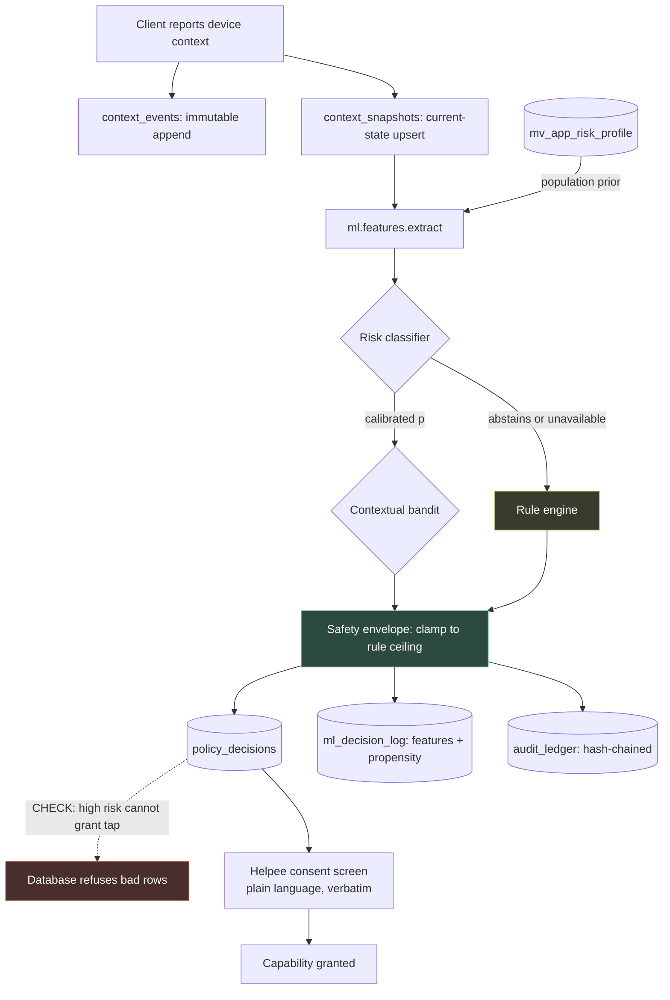

# Architecture Notes — AssistMe / ACSAF

> Reference implementation of the **Adaptive Context-Aware Secure Assistance
> Framework**.
> Deep dives: [`DATABASE_DESIGN.md`](DATABASE_DESIGN.md) ·
> [`CRYPTOGRAPHY_DESIGN.md`](CRYPTOGRAPHY_DESIGN.md) ·
> [`ML_METHODOLOGY.md`](ML_METHODOLOGY.md) ·
> [`threat_model.md`](threat_model.md)

---

## 1. What the system is

An elderly person taps one button; a trusted family member's phone rings; on
accept, the helper sees their live screen, talks to them, draws on it, and — only
with explicit consent — taps on it.

Around that product sits the research framework: what the helper is *permitted*
to do adapts to the helpee's live device context, and that adaptation is learned
rather than hard-coded, inside a safety envelope that learning cannot widen.

---

## 2. Design principles

* **Clean layering** — Routers → Schemas → Services → Models → Database. Routers
  contain no business logic.
* **Least privilege by default** — accepting a help request grants annotation
  only. Anything more is a separate, explicitly consented escalation.
* **Defence in depth for safety properties** — the invariant that matters most
  ("no interactive control at high risk") is enforced in three independent
  places, because one enforcement point for a safety property is one point of
  failure.
* **Fail closed, degrade to rules** — every ML failure path lands on the
  deterministic engine. The system's floor is its pre-ML behaviour.
* **The database enforces what the database can enforce** — domain constraints,
  temporal ordering, interval exclusion, and append-only history are schema
  properties, not conventions fourteen services are each trusted to respect.

---

## 3. Structure

```
AssistMe/
├── backend/
│   ├── app.py                       # FastAPI entry point; /internal prefix (§5)
│   ├── core/
│   │   ├── config.py                # Environment settings, incl. ML runtime
│   │   ├── database.py              # Async engine, RLS-aware session scope
│   │   ├── security.py              # JWT (typ/iss/aud/jti), Argon2id passwords
│   │   ├── crypto/                  # ── Application-layer cryptography
│   │   │   ├── keyring.py           #    Versioned KEK/BIK from the runtime
│   │   │   ├── envelope.py          #    AES-256-GCM envelope encryption
│   │   │   ├── blind_index.py       #    Keyed deterministic search tokens
│   │   │   ├── types.py             #    SQLAlchemy transparent column types
│   │   │   ├── hashing.py           #    Argon2id + keyed pepper
│   │   │   └── rotation.py          #    Offline re-encryption
│   │   └── db/                      # ── Database infrastructure
│   │       ├── dialect.py           #    PostgreSQL-first, SQLite-portable types
│   │       ├── enums.py             #    Database-enforced categorical domains
│   │       └── ddl.py               #    Triggers, partitions, MVs, RLS, EXCLUDE
│   ├── models/                      # ORM models (23 tables)
│   │   ├── audit_ledger.py          #    Append-only, hash-chained, partitioned
│   │   ├── context_event.py         #    Append-only telemetry (ML corpus)
│   │   ├── context_snapshot.py      #    Derived current-state projection
│   │   ├── ml_decision_log.py       #    Decisions + propensities for OPE
│   │   ├── policy_decision.py       #    + policy_decision_capabilities (1NF)
│   │   └── ...
│   ├── ml/                          # ── Research core
│   │   ├── config.py                #    Seeds, action space, cost model
│   │   ├── features.py              #    THE feature contract (train == serve)
│   │   ├── registry.py              #    Versioned artefacts + model cards
│   │   ├── inference.py             #    Runtime entry point, always answers
│   │   ├── risk/{safety,model,evaluate}.py
│   │   ├── bandit/{policies,ope,evaluate}.py
│   │   ├── sequence/{markov,neural,evaluate}.py
│   │   ├── anomaly/{detector,evaluate}.py
│   │   ├── datasets/generators.py   #    Documented generative processes
│   │   └── experiments/run_all.py   #    Reproduces every reported number
│   ├── api/{routers,schemas,services}/
│   ├── migrations/versions/         #    Alembic
│   ├── scripts/db_benchmark.py      #    EXPLAIN ANALYZE harness
│   └── tests/
│       ├── test_crypto.py           #    40 security property tests
│       ├── test_ml_safety.py        #    38 safety-invariant tests
│       ├── test_postgres_schema.py  #    21 real-PostgreSQL behaviour tests
│       ├── test_schema_parity.py     #    migration and ORM must agree
│       └── ...
├── mobile/                          # Flutter client
├── deploy/                          # Docker Compose, k8s, nginx, coturn
└── docs/
```

---

## 4. The decision pipeline

The system's central flow, from a client context report to what the helper is
allowed to do:



The green node is the safety envelope: **every** path passes through it, and it
only ever lowers privilege. The red node is the database's independent
enforcement of the same property. The yellow node is the fallback that every
failure lands on.

---

## 5. The `/internal` prefix

`VISION.md` commits to a deliberately tiny helpee-facing product — "no E2EE
dashboards, no zeroize buttons, no technical jargon anywhere" — and
`tests/test_vision_contract.py` enforces it. The ACSAF roadmap equally requires
Phases 8 and 9 to be implemented, documented, and testable.

Those two commitments were in direct conflict: the Context Engine and Policy
Engine routers existed but **were never mounted**, so the entire adaptive
decision surface was unreachable over HTTP and could not be integration-tested.

Both are now mounted under `/internal`, which keeps the consumer surface exactly
as small as the vision demands while making the framework surface reachable.
`/internal` is a naming convention, not an authorisation boundary — every
endpoint under it enforces the same participant checks, and the edge gateway
should additionally restrict the prefix.

---

## 6. Layer responsibilities

| Layer | Responsibility | Does not |
|---|---|---|
| **Routers** | HTTP shape, Pydantic validation, delegation | Contain business logic |
| **Schemas** | Request/response contracts, OpenAPI documentation | Touch the database |
| **Services** | Domain rules, transactions, authorisation checks | Format HTTP responses |
| **Models** | Table definitions, constraints, relationships | Contain business logic |
| **`core/crypto`** | Confidentiality and credential hashing | Know about tables |
| **`core/db`** | Dialect portability, domain enums, raw DDL | Know about business rules |
| **`ml/`** | Feature extraction, models, evaluation, inference | Grant capabilities |

`ml/` depending on nothing in `api/` is deliberate: the training pipeline must be
runnable without booting the web application.

---

## 7. Database strategy

* **Production**: PostgreSQL 14+, and the schema is designed for it — native
  enums, `JSONB`, range partitioning, exclusion constraints, materialised views,
  row-level security.
* **Tests**: SQLite for business logic (fast, hermetic) and **real PostgreSQL**
  for everything that cannot be emulated (`tests/test_postgres_schema.py`).
* **Portability**: `core/db/dialect.py` compiles each type to the strong
  PostgreSQL construct and degrades on SQLite; anything that cannot degrade
  safely is guarded by `is_postgres()` rather than silently emulated.
* **Migrations**: Alembic. The `try/except ALTER TABLE` bootstrap is gone, along
  with the schema divergence it had quietly created.

Full rationale in [`DATABASE_DESIGN.md`](DATABASE_DESIGN.md).

---

## 8. Authentication and identity

Device-first: the install *is* the identity. No email, no password, no login
screen.

1. First launch registers a stable device fingerprint; the server creates an
   invisible account and returns a one-time recovery code.
2. Later launches present a device secret, verified with Argon2id.
3. Access tokens are JWTs carrying `sub`, `typ`, `iss`, `aud`, `iat`, `nbf`,
   `exp`, `jti`. `typ` and `aud` are what prevent a token minted for one purpose
   being accepted as another — the inherited token carried only `sub/exp/iat`,
   making every HS256 token signed with `SECRET_KEY` interchangeable.
4. Refresh tokens are stored as SHA-256 digests and **rotate on every use**.
   Presenting an already-revoked token revokes the whole family, which is the
   standard detection mechanism for a stolen refresh token (OAuth 2.0 BCP
   §4.13.2).
5. A recovery-code reclaim revokes every existing session, so a stolen phone
   stops working once the owner recovers onto a new one.

---

## 9. Failure modes and degradation

| Failure | Behaviour |
|---|---|
| ML model missing, stale, or throws | Deterministic rules; `decision_source="rules"` |
| Model abstains | Rules; abstention recorded so the rate is measurable in production |
| No context reported | Rules, capped at `voice` — useful and cannot expose anything |
| `mv_app_risk_profile` unavailable | Cold-start feature path; model still runs |
| Database unreachable | Readiness probe fails; the instance is removed from rotation |
| Key material missing in production | **Process refuses to start** — better than running with derived keys |
| Audit chain verification fails | Reported, not swallowed; the entry cannot be repaired, only compensated |

---

## 10. Testing strategy

| Suite | Count | Runs on | Covers |
|---|---:|---|---|
| Business logic | 145 | SQLite | Auth, sessions, pairing, help flow, WebRTC |
| `test_crypto.py` | 40 | — | Every claim in `CRYPTOGRAPHY_DESIGN.md` |
| `test_ml_safety.py` | 38 | — | Envelope invariants, feature contract, bandit safety, reproducibility |
| `test_postgres_schema.py` | 21 | **Real PostgreSQL** | Triggers, partitions, exclusion constraint, RLS, tamper detection |
| `test_schema_parity.py` | 4 | **Real PostgreSQL** | The migration and the ORM build identical schemas |
| **Total** | **248** | | |

The PostgreSQL suite skips without `TEST_DATABASE_URL`. A skipped test is not a
passing test — CI runs a PostgreSQL service so these execute there.

Safety properties are checked by **enumeration**, not sampling: `run_safety_audit`
tries every mode (including malformed strings) against every generated context,
because "no proposal ever exceeds the ceiling" is absolute and a single violation
is a failure.
