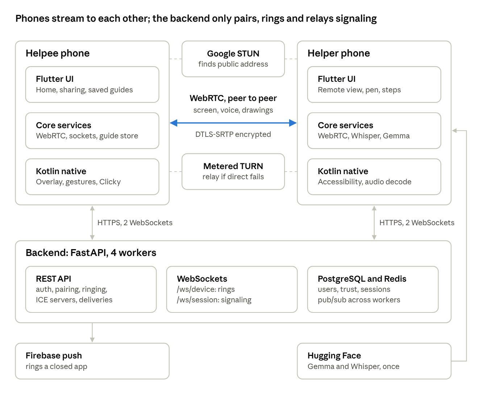

# AssistMe Codebase Guide

AssistMe lets a trusted helper see, guide and annotate a helpee's Android screen live, then leaves the helpee an encrypted step-by-step guide that Clicky can replay offline. This guide maps every part of the code to the feature it implements.

## At a glance

Screen video, voice, drawings and guide steps travel phone to phone. The backend only handles identity, pairing, ringing and signaling, and holds post-call guide ciphertext it cannot read. The helper's phone downloads Gemma and Whisper once, then runs them offline.

## How the code is split

The repository has three layers: a Flutter UI, a native Android layer in Kotlin, and a FastAPI backend. The phones carry all the private work (screen, drawings, screenshots, audio, AI). The backend only knows who is trusted, who is calling, and relays signaling.

| Layer | Folder | Language | What lives there |
| --- | --- | --- | --- |
| UI and app logic | `mobile/lib/features/` | Dart (Flutter) | Screens: onboarding, home, trusted devices, live workspace, guides, settings |
| App core services | `mobile/lib/core/` | Dart | WebRTC engine, WebSocket clients, REST client, secure storage, guide store, Whisper, Gemma, platform bridges |
| Native Android | `mobile/android/app/src/main/kotlin/com/assistme/` | Kotlin | Annotation overlay, accessibility service (gestures, Clicky), screen-capture service, network watch, audio decoder |
| Theme | `mobile/lib/theme/app_theme.dart` | Dart | Colours, typography, light and dark themes |
| API and realtime | `backend/api/` | Python (FastAPI) | REST routers, two WebSocket endpoints, services, Pydantic schemas |
| Infrastructure | `backend/core/` | Python | Config, database engine, Redis bus, JWT, field encryption, rate limits |
| Data model | `backend/models/`, `backend/migrations/` | Python (SQLAlchemy, Alembic) | Tables and schema history |
| Research ML | `backend/ml/` | Python | Risk classifier, anomaly detector, bandit, sequence recommender (used by the internal policy and intelligent-assistance APIs) |
| Deployment | `deploy/` | Docker Compose, Kubernetes, nginx | Backend, Postgres, Redis, nginx, Cloudflare tunnel (coturn is defined but unused by phones) |
| Tests | `backend/tests/` (26 files), `mobile/test/` (11 files) | pytest, flutter\_test | Signaling, sessions, guides, crypto, redaction, Clicky bridge, AI support |
| Docs | `docs/`, `BUGS.md`, `YET_TO_FIX.md` | Markdown | API spec, threat model, crypto design, bug log |

The Flutter layer talks to the native layer through method channels, each named `com.assistme/<name>`: `accessibility`, `annotation_overlay`, `media_projection`, `clicky`, `network`, `local_ai_device` and an audio decoder channel. The app reaches the backend over HTTPS (REST) and two WebSockets. The phones talk to each other directly over WebRTC once a call is set up.

## Backend services and deployment

The backend is one FastAPI app (`backend/app.py`) run by uvicorn with 4 worker processes, backed by PostgreSQL for state and Redis for cross-worker messaging. Media never passes through it: phones stream to each other directly or through Metered TURN.

| Service | Used for | Where it is set up |
| --- | --- | --- |
| FastAPI + uvicorn (4 workers) | REST API, `/ws/device` ring channel, `/ws/session/{id}` call channel | `backend/app.py`, `deploy/docker-compose.yml` service `backend` |
| PostgreSQL 16 | Users, trusted devices, pairings, sessions, participants, assistance requests, guide deliveries, audit ledger, ML logs | `core/database.py` (async SQLAlchemy), `migrations/` (Alembic), compose service `db` |
| Redis 7 | Pub/sub fan-out between workers (`assistme:session:{id}`, `assistme:user:{id}`), presence hash (`assistme:presence2:{id}`, user to latest socket id), parked signals list (`assistme:parked:{id}`, 120 s) | `core/realtime_bus.py`, compose service `redis` |
| Metered TURN (assistme.metered.live) | Relay for phones that cannot connect directly (different networks, strict NAT). Short-lived credentials fetched with `METERED_API_KEY`, cached 10 min | `api/services/webrtc_service.py` |
| Google STUN (`stun.l.google.com:19302`, `stun1`, `stun2`) | Lets each phone learn its public address for direct connections | `webrtc_service.py` |
| Firebase Cloud Messaging | Rings a helper's phone when the app is closed; app registers its token at `POST /help/push-token` | `api/routers/help_flow.py` `_send_fcm_ring`, `firebase-service-account.json` (not committed) |
| Hugging Face (litert-community) | Download source for Gemma 4 E2B and Whisper tiny, fetched by the helper's phone only on request | `mobile/lib/core/guides/local_guide_ai_service.dart`, `local_guide_transcription_service.dart` |
| nginx, Cloudflare tunnel | Public HTTPS front for the cloud deployment | compose services `nginx`, `cloudflared`, `deploy/nginx/` |
| coturn | Defined in compose and k8s but unusable by phones (internal hostname, `EXTERNAL_IP=0.0.0.0`); the ICE builder filters it out | `deploy/coturn/`, `deploy/k8s/coturn-deployment.yaml` |

**Configuration** comes from environment variables read by `core/config.py`: database and Redis URLs, JWT secret, encryption keyring, Metered key and domain, STUN/TURN overrides, allowed CORS origins, and `AUTO_CREATE_TABLES` for development. `/docs` is hidden in production.

**Background work.** On startup the app launches `run_session_sweeper` (`api/routers/session_ws.py`). Every 30 s each worker stamps `last_seen_at` for the sockets it holds and ends sessions nobody has been connected to for 300 s.

## Backend file map

The product runs on a small core: auth, pairing, help calls, sessions, the two WebSockets and guide delivery. The other services are research or earlier-phase features (policy engine, ML, E2EE ratchet, recording, multi-party, chat) that the current app does not call.

### Routers (`backend/api/routers/`): HTTP and WebSocket endpoints

| File | Feature | Core code |
| --- | --- | --- |
| `auth/auth.py` | Device-first sign-in with no email or password | `POST /auth/device` creates an invisible account and a one-time recovery code on first launch, and logs back in later; `POST /auth/device/reclaim` restores an identity from the recovery code; `POST /auth/refresh` issues new access tokens |
| `trusted_devices.py` | Pairing a helper with a 6-digit code | `POST /devices/pairing/setup-code` (owner shows code), `POST /devices/pairing/claim` (helper types it), `GET /devices/pairing/pending` and `POST /devices/pairing/approve` (owner taps Approve), `GET /devices/` (my helpers), `GET /devices/helping` (people I help), `DELETE /devices/{id}`, `POST /devices/identity` |
| `help_flow.py` | One-tap call: tap a trusted person and their phone rings | `place_help_call` checks the trust row is `accepted`, calls `SessionService.get_or_create_pair_session`, creates or reuses an `AssistanceRequest`, then `push_to_user(..., incoming_call)` and `_send_fcm_ring`. Also `GET /help/call/{id}`, `POST /help/call/{id}/cancel`, `POST /help/push-token`, `GET /help/pending` (missed rings) |
| `assistance_requests.py` | Accept or deny a call; ask the helpee for control | `POST /sessions/{id}/assistance/request/{rid}/respond` pushes `call_accepted` or `call_denied`; escalation endpoints create a control request the helpee must approve after a risk disclaimer |
| `device_ws.py` | `/ws/device`, the always-on ring channel | `_device_connections` per user, `push_to_user` publishes to Redis `assistme:user:{id}` so the worker holding the helper's socket delivers `incoming_call`, `call_accepted`, `call_denied`, `call_cancelled` |
| `session_ws.py` | `/ws/session/{id}`, the in-call channel | Authenticates the bearer token, checks participant and session status, registers presence with a per-socket id, relays `signal_offer`, `signal_answer`, `signal_ice_candidate`, `request_offer`, `draw_*`, `remote_control_input`, `screen_share_*`, `hide_controls_for_capture` and more. Parks signals in Redis when the peer is away. On close, `presence_release` ignores stale sockets, otherwise marks the user disconnected, broadcasts `user_disconnected` and starts a 300 s grace timer. Hosts `run_session_sweeper` |
| `sessions.py` | Call lifecycle REST | `POST /sessions/`, `/join`, `GET /sessions/`, `GET /sessions/{id}`, `GET /sessions/{id}/ice-servers` (STUN and TURN list), `/leave`, `/end`, `/recover`, `/heartbeat`, `/audio/mute`, `remote-control/grant`, `revoke`, `input`, `status` |
| `guide_deliveries.py` | Encrypted post-call guide hand-off | `POST /guide-deliveries` (helper uploads AES-GCM ciphertext), `GET /pending`, `GET /{id}`, `DELETE /{id}`; rows expire after 7 days |
| `guides.py` | Legacy server-side guides | List, get, create (screenshots refused), delete; `POST /sessions/{id}/guide/generate` returns 410 because cloud synthesis is disabled |
| `contacts.py`, `users.py` | Trusted contacts, own profile | CRUD on `/contacts`, `GET` and `PATCH /users/me` |
| `health.py` | Health and APK download | `/health`, `/health/live`, `/health/ready`, `/download/apk` |
| `context_engine.py`, `policy_engine.py` | Research: device context and adaptive policy | Mounted under `/internal/...` |
| `intelligent_assistance.py` | Research: task learning and suggestions | Uses the ML inference service |

### Services (`backend/api/services/`): business logic

| File | Feature | Core code |
| --- | --- | --- |
| `auth_service.py` | Device accounts, JWT, recovery codes | `device_bootstrap`, `device_reclaim`, Argon2id-hashed recovery secret |
| `trusted_device_service.py` | Pairing and trust | `generate_setup_code` (15-minute code, stored hashed plus a blind index), `claim_setup_code` (index lookup, not a scan), `approve_pairing`, `list_helping`, `revoke_device` |
| `session_service.py` | Sessions and participants | `get_or_create_pair_session`, `ensure_helper_available`, `mark_disconnected`, `terminate_on_disconnect` (skips if the user is back), `touch_participants` (live stamp, status back to connected), `expire_abandoned_sessions` |
| `assistance_request_service.py` | Help requests and control escalation | `request_help`, respond, escalation with disclaimer text |
| `webrtc_service.py` | ICE server list | `get_ice_servers`: Metered credentials first, then static TURN env, then STUN only; strips `coturn` hostnames |
| `remote_control_service.py`, `voice_service.py` | Control grants and mute state | Permission checks for remote input; audio mute bookkeeping |
| `guide_service.py` | Legacy guide storage | Owner-scoped CRUD |
| `contacts_service.py` | Contacts | Mutual trust edges |
| `policy_engine_service.py`, `intelligent_assistance_service.py`, `context_engine_service.py`, `audit_ledger_service.py` | Research core | Risk and policy decisions, suggestions, hash-chained audit ledger, through `ml/inference.py` with a rules fallback |
| `e2ee_service.py`, `audit_recording_service.py`, `multiparty_service.py`, `chat_file_service.py`, `screen_share_service.py`, `adaptive_streaming_service.py`, `hardening_service.py` | Earlier-phase features | Not imported by any router; their message types are still relayed by `session_ws.py` |

### Core, models and data

| File | Feature | Core code |
| --- | --- | --- |
| `core/realtime_bus.py` | Cross-worker messaging | `publish`, `listen` (Redis pub/sub), `presence_add`, `presence_release` (Lua compare-and-delete), `others_present`, `park_signal`, `take_parked_signals`; every call returns `None` if Redis is down so callers fall back to local buffers |
| `core/security.py` | Tokens | JWT create and decode, secret hashing |
| `core/crypto/` | Field encryption at rest | `envelope.py` (AES-256-GCM per field), `types.py` (encrypting column types), `blind_index.py` (searchable equality on encrypted columns), `hashing.py` (Argon2id with pepper), `keyring.py` and `rotation.py` (versioned keys) |
| `core/database.py`, `core/db/` | Database | Async engine and session factory; `ddl.py` adds triggers, partitions, row-level security; `enums.py` value sets |
| `core/rate_limiter.py` | Abuse limits | Limits on bootstrap, reclaim, pairing and help calls |
| `core/config.py` | Settings | Environment-driven configuration |
| `models/` | Tables | `user`, `device_account`, `trusted_device` (and pairing), `session`, `session_participant` (status, `last_seen_at`), `assistance_request`, `guide_delivery`, `guide`, `refresh_token`, `audit_ledger`, plus research tables |
| `migrations/versions/` | Schema history | Initial schema, unique device usernames, research schema, session guides, purge of uploaded guide images, `f6c3b8e1a920_guide_deliveries` |
| `ml/` | Research models | `risk/` classifier with `safety.py` envelope, `anomaly/` detector, `bandit/` policies, `sequence/` Markov recommender, `inference.py` (always answers, falls back to rules) |
| `scripts/` | Operations | `manage_keys.py` (generate and rotate keys), `db_benchmark.py` |

## Mobile app file map (Flutter)

One app plays both roles: the same install is a helpee (asks for help, shares the screen) or a helper (views, draws, makes the guide). `assistance_flow_coordinator.dart` (3,392 lines) is the call's brain; most other files are screens it opens or services it calls. Key packages: `flutter_webrtc` 1.6, `firebase_messaging`, `flutter_secure_storage`, `cryptography`, `flutter_edge_ai` with `flutter_edge_ai_litertlm` (Gemma) and `flutter_edge_ai_speech` (Whisper).

### Screens and UI (`mobile/lib/features/`)

| File | Feature | Core code |
| --- | --- | --- |
| `main.dart` | App start, theme switching | Global theme notifier, Firebase init, routes into onboarding or home |
| `onboarding/onboarding_screen.dart` | First launch | Asks "What should we call you?", calls device bootstrap, shows the one-time recovery code, offers restore with a recovery code |
| `home/home_screen.dart` | Home: "I need help" and "I'm helping" tabs | `_generateMyCode` (show 6-digit code), `_submitCode` (helper enters it), approval prompt, `_ringHelper` (`placeHelpCall`, then polls status), `_connectChannel` and `_onChannelEvent` (ring channel), `_showIncomingDialog`, `_respondIncoming`, `_openLiveSession`, `_reconnectActiveSession`, `_checkMissedCalls`, `_syncGuides` (collect post-call deliveries) |
| `devices/trusted_devices_screen.dart` | Security centre | Lists and revokes trusted helpers |
| `workspace/mobile_workspace_screen.dart` | The call screen | Hosts the coordinator; shows the remote video for the helper and the status card for the helpee; mic, end call, "Request Control", "Capture step for guide" |
| `workspace/assistance_flow_coordinator.dart` | Everything during a call | `_bootstrap` (ICE servers, WebSocket), `_initMediaEngine`, `startScreenShare`, `_handleIncomingOffer`, `_onEvent` (every message type), drawing send and receive, `sendRemoteInput`, `_requestEscalation`, `captureGuideStep`, `_sendGuideFrameToHelpee`, `_offerLocalGuideSave`, `_sendGuideFinalization`, `_receiveFinalizedGuide`, guide audio consent, network-switch recovery, helper-away countdown, `_panicStop` |
| `workspace/remote_screen_view.dart` | Helper's view of the helpee's screen | Renders the remote video, turns finger movement into normalised 0..1 points for drawing, and taps or drags into `remote_control_input` only after control is granted |
| `workspace/drawing_overlay.dart` | Stroke rendering in Flutter | `CustomPainter` for committed strokes and the live draft |
| `workspace/screenshot_redaction_editor.dart` | Privacy review of a captured frame | Helper drags boxes over private details; returns a PNG with solid blocks burned in |
| `workspace/screenshot_review_sequence.dart` | After-call screenshot review | Full-screen "Screenshot 2 of 5" with Cover private parts, Looks good, Remove and Skip all |
| `workspace/local_guide_save_dialog.dart` | "Save a private guide?" | Title, transcript or notes, "Transcribe call locally" (Whisper), "Improve steps with Gemma", written steps without a screenshot, Discard or Save |
| `workspace/incoming_help_request_popup.dart` | Helper's ring popup | Accept or decline |
| `workspace/risk_disclaimer_modal.dart` | Before control is granted | Helpee reads the risk text and approves or refuses |
| `workspace/mobile_voice_control_bar.dart` | Call controls | Large mic and end-call buttons |
| `guides/my_guides_screen.dart` | Saved guides list | Search and open guides from the encrypted local store |
| `guides/guide_detail_screen.dart` | Guide viewer | High-contrast step-by-step view with screenshots, read-aloud, "Use Clicky", session transcript |
| `settings/settings_screen.dart` | Settings | Dark theme, notifications, server URL, how-to guide, about |
| `settings/local_ai_settings_card.dart` | On-device AI card | Device check result, "Download models" (Gemma about 2.6 GB, Whisper about 150 MB), self-test |
| `theme/app_theme.dart` | Look and feel | Colour tokens, typography scale, light and dark themes |

### Core services (`mobile/lib/core/`)

| File | Feature | Core code |
| --- | --- | --- |
| `config/app_config.dart`, `config/server_config_dialog.dart` | Backend address | `DEFAULT_SERVER_URL` dart-define, `wsUrl`, in-app server dialog with a connection test |
| `network/api_client.dart` | REST client | Adds the bearer token, refreshes it on 401, wraps every endpoint (`deviceBootstrap`, `placeHelpCall`, `claimSetupCode`, `requestEscalation`, ...) and sends `ngrok-skip-browser-warning` |
| `realtime/device_channel_service.dart` | Ring channel client | Keeps `/ws/device` open and reconnects; emits `incoming_call`, `call_accepted`, ... |
| `realtime/realtime_service.dart` | Call channel client | `/ws/session/{id}` with bearer header, 10 s heartbeat, queue of up to 32 messages while offline, back-off reconnect, `reconnectNow()` after a network change, discards stale SDP and ICE on reconnect |
| `webrtc/webrtc_engine.dart` | Media and data link | Peer connection (unified plan, `gather_continually`, optional relay-only), `getDisplayMedia` at 30 fps, `getUserMedia` mic, 2.5 Mbps cap, reliable channel `assistme_channel` and unordered `assistme_channel_preview`, `sendData`, `sendPreviewData`, `captureScreenFrame`, ICE restart, 5 s diagnostics |
| `notifications/push_notification_service.dart` | Rings while the app is open | Shows FCM rings as local notifications |
| `security/secure_storage_service.dart`, `security/device_identity.dart` | Secrets and identity | Tokens and keys in Android Keystore-backed storage; stable device fingerprint for pairing |
| `platform/annotation_overlay_service.dart` | Bridge to the native drawing layer | `start`, `updateStrokes`, `clear`, `hideControlsFor`, `stop` |
| `platform/accessibility_bridge.dart` | Bridge to the accessibility service | `isEnabled`, `openSettings`, `dispatchInput` |
| `platform/clicky_bridge.dart` | Bridge to Clicky | `start` with the guide's steps, `stop`, `isActive` |
| `platform/network_monitor.dart` | Network change events | Stream of Wi-Fi or mobile data changes from the `network` channel |
| `guides/guide_models.dart` | Data types | Transcript, guide and step models |
| `guides/session_keyframe_manager.dart` | Guide frames during a call | Holds captured frames, drops near-duplicates with a 64-bit difference hash |
| `guides/screenshot_redaction.dart` | Image processing | Burns redaction boxes; `shrinkGuideScreenshot` to 1280 px longest side |
| `guides/local_guide_store.dart` | Encrypted local guides | AES-256-GCM with a key kept in secure storage; files `<id>.guide.enc` and `<id>_<n>.frame.enc` in app-private storage |
| `guides/local_guide_audio_capture.dart` | Call audio for transcripts | Records the input and output WebRTC audio taps to the app cache, deleted after transcription or discard |
| `guides/local_guide_transcription_service.dart` | Speech to text | Whisper tiny (LiteRT) at 16 kHz, split into 30 s windows |
| `guides/local_guide_ai_service.dart` | Guide writing | Gemma 4 E2B: per-step drafts from screenshot plus transcript, or 1 to 8 steps from the transcript alone; self-test |
| `guides/local_ai_device_support.dart` | Can this phone run it? | Checks 64-bit ARM, RAM, free space; picks vision, text-only or unavailable |
| `guides/guide_delivery_service.dart` | Post-call delivery | `newKey`, `rememberKey`, `sendAfterCall` (encrypt and upload), collect and decrypt pending deliveries |

## Native Android layer (Kotlin)

The Kotlin layer does what Flutter cannot: draw on top of other apps, inject the helper's taps, capture the screen as a foreground service, guide the user with Clicky, and watch the network. All files are in `mobile/android/app/src/main/kotlin/com/assistme/`.

| File | Feature | Core code |
| --- | --- | --- |
| `MainActivity.kt` | Method channels and system hooks | Registers `com.assistme/accessibility`, `annotation_overlay`, `media_projection`, `clicky`, `network` and `local_ai_device`. `startNetworkWatch` uses `registerDefaultNetworkCallback` and calls `changed` with the new transport. `hasNativeLibrary` looks inside the APK, because native libraries are not extracted (`extractNativeLibs=false`) |
| `service/AssistMeAnnotationOverlayService.kt` | Helpee's drawing layer and toolbar | Full-screen canvas window that draws the helper's strokes over any app, plus a small helpee-only toolbar (drag handle, STOP and other controls). Uses `TYPE_ACCESSIBILITY_OVERLAY` when the accessibility service is on, so drawings show above the notification shade. Toolbar is translucent (45% folded, 90% open), starts folded, folds itself after 6 s, and is not `FLAG_SECURE`, so it no longer shows as a black box. `hideControlsFor(ms)` hides it for guide screenshots. Strokes map from normalised points to screen pixels using `currentWindowMetrics` and `getLocationOnScreen`, with the cutout mode set to always |
| `service/AssistMeAccessibilityService.kt` | Remote control and Clicky host | `dispatchInput` turns normalised events into real-pixel taps, drags (a 450 ms dwell for drag and drop), long presses and key events through `dispatchGesture`. It makes the toolbar pass-through for 60 ms first, so the helper's gesture reaches the app underneath. It detects sensitive screens (password fields, banking, 2FA, permission prompts) and creates the Clicky controller lazily |
| `service/AssistMeMediaProjectionService.kt` | Screen-capture foreground service | Starts the `mediaProjection` foreground service and notification before `getDisplayMedia` (required on Android 14 and later) and stops it when sharing ends |
| `clicky/ClickyGuideController.kt` | Clicky walkthrough | Floating card that shows and speaks (TextToSpeech) the current step, plus a blue pointer that flies to the control. Back, Finish and Close buttons. It reads the accessibility tree only (labels and bounds), never taps for the user, never reads password fields, and hides on sensitive screens |
| `clicky/ClickyTargetMatcher.kt` | Finding the control a step means | Pulls labels from the step: quoted text first ("Settings"), then action phrases ("tap Wi-Fi"), then a short title. It normalises tokens (lowercase, punctuation, light stemming, keeps Devanagari) and scores each visible element 0 to 100 |
| `LocalGuideAudioDecoder.kt` | Audio for Whisper | Decodes a cached call recording to mono 16 kHz PCM16 |

Two Android settings the user must allow: **Display over other apps** (overlay fallback) and **AssistMe accessibility service** (remote control, Clicky, overlay above the shade). Screen sharing needs the system "Start recording or casting" consent each time.

## Connecting two devices

Two phones connect in four stages. Pairing happens once. The ring goes over the device WebSocket and FCM. Signaling goes over the session WebSocket. Media and data then flow phone to phone over WebRTC, directly or through Metered TURN.

**1. Identity (once per install).** `onboarding_screen.dart` calls `POST /auth/device`. The backend creates a device account and returns a JWT plus a one-time recovery code. Tokens are kept in `secure_storage_service.dart`, and `api_client.dart` refreshes them on 401.

**2. Pairing (once per helper).**

1. Helpee taps **Show My 6-Digit Code**, which calls `POST /devices/pairing/setup-code`. The code lasts 15 minutes and is stored hashed plus a blind index.
2. Helper opens **I'm helping**, types the code and taps Connect (`POST /devices/pairing/claim`).
3. Helpee sees the request (`GET /devices/pairing/pending`) and approves it (`POST /devices/pairing/approve`). The `TrustedDevice` row becomes `accepted`, and each side now lists the other.

**3. Ringing (every call).**

1. Both phones keep `/ws/device` open (`device_channel_service.dart`).
2. Helpee taps **Call** and optionally types what they need help with. `home_screen.dart` `_ringHelper` calls `POST /help/call`.
3. `help_flow.py` checks the trust row, reuses or creates the pair `Session` and an `AssistanceRequest`, then calls `push_to_user`. That publishes `incoming_call` on Redis `assistme:user:{helper}`, and whichever worker holds the helper's socket delivers it. An FCM push is also sent, so a closed app still rings.
4. Helper taps Accept. `POST /sessions/{id}/assistance/request/{rid}/respond` pushes `call_accepted` to the helpee, and both phones open `mobile_workspace_screen.dart`.

**4. Signaling and WebRTC (every call).**

1. Each coordinator runs `_bootstrap`: `GET /sessions/{id}/ice-servers` (Google STUN plus Metered TURN credentials), then `RealtimeService.connect()` to `/ws/session/{id}` with the bearer token. The backend checks the user is a participant and the session has not ended, then records presence in Redis with a new socket id.
2. Helpee taps **Start Sharing** and approves Android's "Start recording or casting" prompt. `webrtc_engine.dart` starts the media-projection foreground service, captures the screen with `getDisplayMedia` (30 fps) and the mic with `getUserMedia`, adds both tracks, and creates the two data channels.
3. **The helpee is always the offerer.** It sends `signal_offer` over the session WebSocket. The backend forwards it to the helper's socket. If the helper is connected to another worker, the offer goes over Redis pub/sub. If the helper is not connected yet, it is parked in Redis for 120 s and replayed when they connect.
4. Helper applies the offer, adds its mic track and replies with `signal_answer`. Both sides trickle `signal_ice_candidate` messages.
5. ICE tries direct paths first: local addresses, then public addresses learned from STUN. If none works (different networks, strict NAT, college firewall), it uses a Metered TURN relay. If ICE fails, the coordinator retries relay-only (`_retryUsingRelay`, `request_relay_offer`). If the helper joins or reconnects without video, it sends `request_offer` and the helpee makes a fresh offer.
6. Once connected, the helpee's screen video and both voices flow over SRTP (DTLS-encrypted), with the bitrate capped at 2.5 Mbps. Drawings, gestures and guide messages go over the data channels. The session WebSocket stays open for control events and as a fallback.

The server only sees signaling metadata (SDP and candidates). Screen pixels, audio and guide content never pass through it, except post-call guide ciphertext it cannot decrypt.

## Screen sharing and remote touch control

Watching is the default. Touch control is opt-in: the helpee must approve it after a risk warning, can withdraw it at any time, and keeps a STOP control the helper cannot reach.

**Screen sharing.** `startScreenShare` in the coordinator runs the steps from the previous section. Then it sends `screen_share_start`, starts the helpee's native overlay (`_startHelpeeOverlay`), and shows "Screen Sharing Active" with a **Stop Sharing** button. The helper's `remote_screen_view.dart` renders the remote video track at the helpee's real display size. Stopping sends `screen_share_stop` and stops the foreground service.

**Getting control.**

1. Helper taps **Request Control**, picks what they need (`_promptCapabilities`) and the app calls the escalation endpoint (`_requestEscalation`).
2. The backend sends `escalation_requested` with the disclaimer text to the helpee, who sees `risk_disclaimer_modal.dart`.
3. If the helpee approves, `_ensureAccessibilityService` checks the AssistMe accessibility service is on and opens Android settings if it is not. The approval sends `escalation_responded` with status `approved`, which sets `_remoteControlGranted` on the helper.

**Sending a touch.** In control mode, the helper's taps and drags on the remote view become a `remote_control_input` event with normalised coordinates (0 to 1) and a gesture type. `sendRemoteInput` sends it over the reliable data channel, or over the WebSocket if that channel is closed. The helpee's coordinator passes it to `AccessibilityBridge.dispatchInput`, and `AssistMeAccessibilityService` scales it to real pixels and performs it with `dispatchGesture` (tap, drag, 450 ms dwell for drag and drop, long press, key events).

**Safety rails.**

- The helpee's toolbar turns pass-through only for the instant of an injected gesture, so the helper can use apps beneath it but not press its STOP button.
- When control events travel through the backend, it rejects any that land in the top strip (about 8%) where the STOP dock sits.
- The accessibility service spots password fields, banking, 2FA and permission screens.
- `remote_control_revoked` and the helpee's STOP (`_panicStop`) end control or the whole call at once.

Without control the helper's finger draws instead (next section).

## Annotations: how a stroke travels

A helper's stroke reaches the helpee's screen as normalised points over the peer data channels: live previews every 32 ms on an unreliable channel, then one committed stroke on the reliable one. The helpee's native overlay draws it above whatever app is open.

1. **Draw.** The helper picks a pen colour and thickness in the annotation toolbar. `remote_screen_view.dart` converts each finger position on the video into fractions of the helpee's screen (x and y from 0 to 1), so different screen sizes line up.
2. **Preview while drawing.** `_sendDrawPreview` batches points every 32 ms into `draw_preview` with `stroke_id`, `preview_sequence`, the points (4 decimals), the colour (ARGB) and the width. It goes on `assistme_channel_preview`, which is unordered with a 50 ms retransmit limit, and is dropped if more than 64 KB is queued. If that channel is down, only the newest preview goes over the WebSocket, at most 10 per second.
3. **Commit on lift.** `_sendDrawStroke` sends the full `draw_stroke` on the reliable `assistme_channel`, or over the WebSocket if it is closed. Eraser, undo, redo and clear send `draw_erase`, `draw_undo`, `draw_redo` and `draw_clear` the same way. Strokes that travel through the backend are validated and their point count capped.
4. **Receive.** The helpee's `_onEvent` adds the stroke to its list. Stroke ids and preview sequence numbers stop late previews from overwriting a newer stroke. `_pushOverlay` then calls `AnnotationOverlayService.updateStrokes`.
5. **Draw on the helpee's screen.** `AssistMeAnnotationOverlayService.kt` converts fractions to pixels using the real window size and position (`currentWindowMetrics`, `getLocationOnScreen`, cutout mode always). It paints on a full-screen, touch-through window, above the notification shade when the accessibility service is on.
6. **Both sides see the same picture.** The helper sees the strokes in Flutter's `drawing_overlay.dart` over the video. The helpee can draw too (`_handleNativeHelpeeStroke`), and those strokes go back the same way.

## Guides: capture, redaction, saving and delivery

The helper builds the guide during the call, one reviewed screenshot at a time. Each step is sent to the helpee as it is made. At the end the helper saves it (optionally with a Whisper transcript and Gemma-written steps), and it reaches the helpee over the data channel, or later as encrypted post-call delivery. Guides are never stored readable on any server.

**Capturing a step (helper, during the call).** One tap, nothing to type, so the helper never stops helping.

1. Helper taps **Capture step for guide** (`captureGuideStep`), or the helpee taps **Request a guide screenshot**, which sends `guide_screenshot_request` to the helper.
2. The helper sends `hide_controls_for_capture` (1,500 ms) so the helpee's overlay toolbar hides itself, then waits 700 ms.
3. `webrtc_engine.captureScreenFrame(remoteStream)` grabs one frame from the received video. `shrinkGuideScreenshot` limits it to 1,280 px on the longest side.
4. `SessionKeyframeManager.addHelperCapture` keeps it on the helper's phone, marked not yet reviewed. Nothing is sent to the helpee until it has been reviewed.

**Reviewing (helper, right after the call).** `reviewScreenshotsInOrder` (`screenshot_review_sequence.dart`) shows each screenshot full screen, "Screenshot 2 of 5". **Cover private parts** opens the redaction editor (`screenshot_redaction_editor.dart`), which burns solid blocks into a new PNG because blur can leave text readable. **Looks good** moves on, **Remove** drops it, and **Skip all** keeps the rest as they are when nothing needs covering.

**Saving (helper).** `_offerLocalGuideSave` then opens **Save a private guide?** (`local_guide_save_dialog.dart`) with `autoGenerate`. If the models are installed, it transcribes the call with Whisper and has Gemma write a title and instruction for every screenshot, or 1 to 8 written steps when there are no screenshots, without the helper pressing anything. Nothing is downloaded automatically. The helper can edit any step, add written steps, or discard. Save encrypts the guide with AES-256-GCM under a key held in secure storage and writes `<id>.guide.enc` plus one `<id>_<n>.frame.enc` per screenshot in app-private storage.

**Delivery to the helpee.**

- **Live path:** `_sendGuideFinalization` first sends each reviewed screenshot (`guide_frame_start`, base64 `guide_frame_chunk` messages paused while more than 96 KB is queued, `guide_frame_finish`), then `guide_finalize` (title, summary, transcript, step list) over the data channel. It retries 6 times at 500 ms intervals, then waits up to 10 s for `guide_finalize_ack`. The helpee's `_receiveFinalizedGuide` combines it with the frames it already has and saves it in its own encrypted store. Choosing Discard sends one `guide_finalize` with `saved: false` and leaves at once.
- **Post-call path:** at the start of the call the helper sends a random AES key in `guide_frame_sync_key` over the DTLS data channel. If the live path fails (helpee hung up, network dropped, Gemma still working), `GuideDeliveryService.sendAfterCall` encrypts the guide with that key and uploads only ciphertext to `POST /guide-deliveries`. The helpee's home screen (`_syncGuides`) lists `/guide-deliveries/pending`, downloads, decrypts and saves each guide, then deletes the row. Rows expire after 7 days.

**Viewing.** `my_guides_screen.dart` lists the decrypted guides. `guide_detail_screen.dart` shows "Step 1 of N" with the screenshot and instruction, reads it aloud, shows the transcript, and offers **Use Clicky** and **Finish Guide**.

## Voice and on-device AI

The call's voices are live WebRTC audio. For guides, the helper's phone can record the call with the helpee's consent, transcribe it with Whisper tiny, and draft steps with Gemma 4 E2B. All of this runs on the helper's phone, and the models are downloaded once on request from Hugging Face.

**Live voice.** Both phones send their mic with `getUserMedia` as a WebRTC audio track, so audio is peer to peer and encrypted. Mute toggles the local track and tells the other side (`toggleAudioMute`, `audio_mute_toggle`).

**Recording for a guide (consent first).**

1. Helper taps the guide-audio control. The helpee is asked (`guide_audio_consent_request`) and answers `guide_audio_consent`. Without a yes, nothing records.
2. `_startHelperGuideAudio` starts `LocalGuideAudioCapture`. It records the helper's mic (input) and the helpee's voice (output) from `flutter_webrtc`'s native audio taps into the app cache. The limit is 20 minutes per call. The helpee sees the status and can revoke at any time, which stops and discards it. It also stops if the data channel closes.
3. Audio is never uploaded. It is deleted after transcription or when the guide is discarded (`_deletePendingGuideAudio`).

**Whisper (speech to text).** **Transcribe call locally** in the save dialog runs `LocalGuideTranscriptionService`. `LocalGuideAudioDecoder.kt` decodes the recording to mono 16 kHz PCM16. The audio is cut into 30-second windows and transcribed by Whisper tiny (`whisper_tiny_30s_f32.tflite` from `litert-community/whisper-tiny`, tokenizer from `openai/whisper-tiny`) through `flutter_edge_ai_speech`. The text fills the transcript box, where the helper can edit it.

**Gemma 4 E2B (writing steps).** `LocalGuideAiService` loads `gemma-4-E2B-it.litertlm` (about 2.6 GB, repo `litert-community/gemma-4-E2B-it-litert-lm`, pinned to commit `1caa527c`) with `flutter_edge_ai_litertlm`. It has two modes:

- **Improve a screenshot step:** the prompt holds the screenshot (vision), the helper's step name and note, and the clipped transcript. It asks for exactly `TITLE:` and `ACTION:` lines (up to 220 tokens).
- **Steps from the transcript only:** it asks for 1 to 8 lines of `STEP: title | instruction` (up to 600 tokens).

The helper reviews and edits Gemma's output before saving. Prompts tell the model not to repeat secrets.

**Will it run on this phone?** `LocalAiDeviceSupport` checks before downloading anything: 64-bit ARM (LiteRT ships `arm64-v8a` only), RAM, and free space. It reports vision-capable, text-only (too little RAM for the vision encoder) or unavailable, with a plain reason. Emulators (x86\_64) always get "not available".

The service tries the GPU first and falls back to the CPU. It writes a marker before each GPU load, so if the driver crashes the app, the next launch stays on the CPU. On low-memory phones it uses smaller screenshots and a shorter context. The settings card (`local_ai_settings_card.dart`) downloads the models and runs a self-test. On the Samsung M34 the self-test loaded on the GPU in about 48 s.

## Clicky: replaying a guide offline

Clicky lets the helpee redo a saved guide alone with no internet. A floating card shows and reads out each step, and a blue pointer moves to the button the step names. It only guides and never taps for the user.

1. **Start.** In `guide_detail_screen.dart` the helpee taps **Use Clicky**. The button only appears on guides this phone received: a guide the helper made follows the helpee's phone, whose screens can differ (`SessionGuideItem.madeByMe`). `clicky_bridge.dart` sends the steps over `com.assistme/clicky`, and `MainActivity.startClickyGuide` hands them to the running `AssistMeAccessibilityService`.
2. **Show the step.** `ClickyGuideController.kt` opens its card as a `TYPE_ACCESSIBILITY_OVERLAY` window, which needs no overlay permission and never blocks the user's taps. The card shows "Step 1 of N", the instruction, Back, Next or Finish, and a speaker button. It reads the step aloud with Android TextToSpeech on the accessibility audio stream, so a muted media volume or audio left on the earpiece after a call does not silence it. If the phone's language has no voice installed, it falls back to English.
3. **Work out what to point at.** `ClickyTargetMatcher.kt` pulls the labels the step mentions, in order: quoted text first ("Settings", then "Connected devices"), then action phrases such as "tap Wi-Fi", then a short step title. Steps done on the screen itself ("long-press an empty part of the home screen", "swipe up") become an area hint instead of a label to search for.
4. **Find it on screen.** On each accessibility event, the controller lists the visible labelled elements with their bounds (and, for unlabelled icon buttons, a lower-ranked label taken from the view id). It scores each against the current label from 0 to 100. Confirm buttons stand in for each other, so a guide that says "Next" still finds "Done" or "Apply".
5. **Point, steadily.** A new target must look the same on two scans 250 ms apart before the pointer flies to it. The pointer stays on the control it is on while that control is still there, follows it in a straight glide when it scrolls, and is only hidden after two empty scans in a row. The card moves to the other end of the screen only when it would cover the target. For an area step, the whole screen is outlined with the prompt.
6. **Move on.** Tapping the target (or doing the press-and-hold or swipe) completes the step. If the target is missing for three scans but the next step's control is clearly on screen, Clicky moves on by itself. A step that repeats the button just pressed counts as done.
7. **Back and Stop.** **Back** shows the previous step and takes the phone back to the screen where that step is done, pressing the system Back key (or Home) up to four times and then reopening that app if needed. The **✕** button stops partway and brings the user back to the AssistMe guide. After the last step the card says "All done!" and closes itself a few seconds later.

Clicky works only from the accessibility tree: it takes no screenshots, sends nothing off the phone, skips password fields and hides on sensitive screens. Its own card and pointer events are ignored so it does not react to itself.

## Reliability: reconnects, network switches, multiple workers

A call survives a dropped socket, a Wi-Fi and mobile data switch, a phone briefly leaving the app, and phones served by different backend workers. It ends only when someone leaves or a participant is gone for 5 minutes.

| Situation | What happens | Where |
| --- | --- | --- |
| Session WebSocket drops | Client reconnects with back-off (2 s up to 30 s), queues up to 32 messages, drops stale SDP and ICE, and the call renegotiates on reconnect | `realtime_service.dart` |
| Wi-Fi and mobile data switch | Native `registerDefaultNetworkCallback` raises a network change, debounced 800 ms. `_recoverFromNetworkChange` (at most once per 8 s) calls `reconnectNow()`, the helpee re-offers and the helper sends `request_offer`. ICE gathers continually, and a 5 s "ICE disconnected" watchdog recovers even with no callback | `MainActivity.kt`, `network_monitor.dart`, coordinator |
| ICE fails | Retry relay-only through TURN (`_retryUsingRelay`). Without TURN, the helper asks for a fresh direct offer | coordinator, `webrtc_engine.dart` |
| Offer sent while the peer is on another worker or not yet connected | Published over Redis if the peer is present anywhere, otherwise parked in `assistme:parked:{id}` for 120 s and replayed on connect | `session_ws.py` `_relay_to_absent_peer`, `realtime_bus.py` |
| Old socket closes after the new one connected | Each socket has an id. Redis keeps the latest per user, so a stale close is ignored: no "disconnected", no countdown, no grace timer | `presence_add`, `presence_release` |
| Participant really disconnects | Marked `disconnected`, the other phone hears `user_disconnected`, and a 300 s grace timer starts. Rejoining sends `user_reconnected` | `session_ws.py` |
| Helpee sees "helper disconnected" | 30 s countdown with Wait (+30 s, up to 5 min) and Leave Now. It cancels on `user_reconnected`, ICE connected, data channel open or any data from the helper, and never leaves at zero while the link is alive | coordinator `_endPeerAwayCountdown` |
| Phone crashed or lost power | The sweeper (every 30 s) stamps live sockets and ends sessions idle for 300 s; the grace timer spares anyone stamped after the drop | `run_session_sweeper`, `session_service.py` |
| App reopened mid-call | Home screen finds the active session and rejoins it (`/sessions/recover`, `_reconnectActiveSession`) | `home_screen.dart` |
| Missed ring while offline | FCM push, and `GET /help/pending` on next launch | `help_flow.py`, `home_screen.dart` |

The bug log in `BUGS.md` (B1 to B29) records each failure found on the two test phones (ASUS A069P and Samsung M34) and its fix.

## The typical flow, end to end

One full run, from installing the app to replaying the guide offline, with the code that handles each step.

| # | Who | What they see or do | What runs |
| --- | --- | --- | --- |
| 1 | Both | Welcome screen, enter a name, note the recovery code | `onboarding_screen.dart` to `POST /auth/device`; tokens in secure storage |
| 2 | Helper (optional) | Settings, On-device guide AI, Download models, self-test | `local_ai_settings_card.dart`, `LocalAiDeviceSupport`, `LocalGuideAiService`, `LocalGuideTranscriptionService` |
| 3 | Helpee | Show My 6-Digit Code | `POST /devices/pairing/setup-code` |
| 4 | Helper | I'm helping, enter code, Connect | `POST /devices/pairing/claim` |
| 5 | Helpee | Approve the helper | `POST /devices/pairing/approve`; both lists refresh |
| 6 | Helpee | Your Trusted Helpers, Call, optional reason, Call Now | `_ringHelper` to `POST /help/call`; `incoming_call` through Redis to `/ws/device`, plus FCM |
| 7 | Helper | Incoming call popup, Accept | `incoming_help_request_popup.dart`, `respond`; `call_accepted` to the helpee |
| 8 | Both | Call screen opens; the helper sees "Waiting for the other device to share" | `mobile_workspace_screen.dart`, coordinator `_bootstrap`: ICE servers, `/ws/session/{id}` |
| 9 | Helpee | Start Sharing, system consent, "Screen Sharing Active" | Foreground service, `getDisplayMedia`, mic, data channels, `signal_offer` |
| 10 | Helper | Sees the helpee's screen live and talks | `signal_answer`, ICE (STUN or Metered TURN), `remote_screen_view.dart` |
| 11 | Helper | Draws circles and arrows | `draw_preview` and `draw_stroke` over data channels to the native overlay |
| 12 | Helper (optional) | Request Control; helpee accepts the risk warning; helper taps for them | Escalation, `risk_disclaimer_modal.dart`, `remote_control_input`, `dispatchGesture` |
| 13 | Helper (optional) | Starts guide audio after the helpee consents | `guide_audio_consent_*`, `LocalGuideAudioCapture` |
| 14 | Helper | Capture step for guide (one tap) | `captureGuideStep`, `addHelperCapture` |
| 15 | Either | End call | `leave`; the helper gets the save dialog |
| 16 | Helper | Review each screenshot (or Skip all), then save; transcript and steps are written automatically | `reviewScreenshotsInOrder`, Whisper, Gemma, `LocalGuideStore` (AES-GCM) |
| 17 | Helpee | Guide appears in My Guides | `guide_finalize` over the data channel, or post-call delivery through `/guide-deliveries` |
| 18 | Helpee, later and offline | Open the guide, Use Clicky, follow the pointer to "All done!" | `guide_detail_screen.dart`, `ClickyBridge`, `ClickyGuideController`, `ClickyTargetMatcher` |
