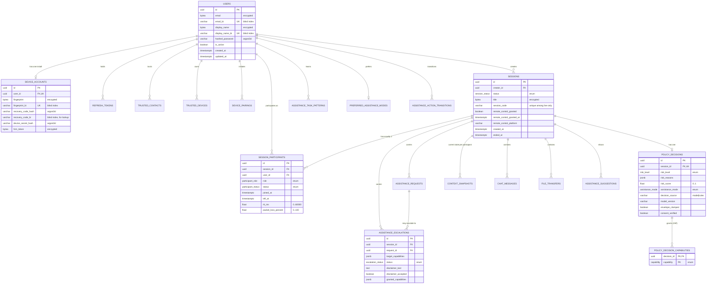
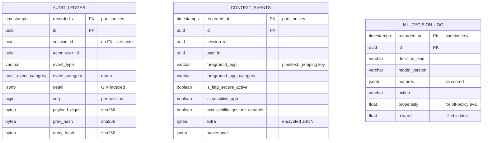

# Database Design

> PostgreSQL 14+ · SQLAlchemy 2.0 · Alembic
> Companion documents: [`CRYPTOGRAPHY_DESIGN.md`](CRYPTOGRAPHY_DESIGN.md),
> [`ML_METHODOLOGY.md`](ML_METHODOLOGY.md), [`threat_model.md`](threat_model.md)

This document explains the schema: what it stores, why it is shaped that way,
and which decisions were reversed from the inherited prototype. It is written to
be argued with — every non-obvious choice states its alternative and why that
alternative was rejected.

---

## 1. What the schema has to be good at

Four workloads share one database, and they want different things:

| Workload | Shape | Dominant cost |
|---|---|---|
| **Live session** | Point lookups by session or user, on the hot path of a call between two people | Latency. A slow query is a stalled assistance session. |
| **Audit and review** | Time-windowed scans over an append-only history | I/O volume; the table grows forever |
| **ML training** | Full scans of ordered event history | Sequential throughput |
| **Analytics** | Multi-way aggregates over sessions, users, and apps | Recomputation cost |

Serving all four from one physical design is the central tension. The
resolution is that the live path gets narrow partial indexes over the small
subset of rows that are actually live, history goes into range-partitioned
append-only tables, and analytics reads pre-computed materialised views instead
of joining at query time.

---

## 2. Entity–relationship diagram



### Append-only tables (partitioned, no foreign keys)



These three carry **no foreign keys**, deliberately. Audit history must survive
the deletion of the session and account it describes — a record that disappears
when someone deletes their account is not an audit trail — and the ML training
corpus must outlive its sources for the same reason. Referential integrity is
traded for durability of the record, which is the correct priority here and the
opposite of the right answer for the operational tables.

---

## 3. Normalisation

### 3.1 Functional dependencies and normal form

Every table is in **BCNF**. The non-obvious cases:

**`sessions`** — key `id`. `session_code` is a candidate key among live rows
only (see §5.3), so `id → session_code` and the partial-unique
`session_code ⇸ id` both hold without violating BCNF. The recording columns
(`recording_scope`, `recording_url`, `recording_file_size_bytes`,
`recording_duration_seconds`) depend only on `id` and are nullable together;
they are not a separate entity because a session has at most one recording and
splitting would add a join to every session read for a feature used by a
minority of sessions. This is a deliberate denormalisation of an optional
1:1 group, and the coherence constraints in §4 do the work a separate table's
NOT NULLs would have done.

**`session_participants`** — key `id`, with `(session_id, user_id)` unique. The
QoS columns (`rtt_ms`, `video_bitrate_kbps`, …) are the *current* values, not a
time series; the time series lives in `context_events`. Keeping only the latest
here is what makes the live read a single row.

**`context_snapshots`** — key `id`, with `(session_id, user_id)` unique. Every
column is functionally dependent on that pair. The table is **fully derivable**
from `context_events`, which makes it a materialised projection rather than a
second source of truth: it can be dropped and recomputed. That is the property
that makes the redundancy safe.

**`policy_decision_capabilities`** — key `(decision_id, capability)`. A pure
association with no non-key attributes, so BCNF is trivial.

### 3.2 The 1NF violations that were fixed

The inherited schema violated first normal form in four places, and each caused
a concrete defect rather than a theoretical one:

| Column | Was | Defect | Now |
|---|---|---|---|
| `policy_decisions.negotiated_capabilities` | `TEXT` holding `'["voice","tap"]'` | `WHERE ... LIKE '%tap%'` could not use an index and matched substrings in other values | `policy_decision_capabilities` relation with an enum domain |
| `policy_decisions.risk_reasons` | `TEXT` joined with `", "` | The service split on `", "`, so a reason containing a comma — e.g. `"sensitive app in foreground: com.bank.app, protected content"` — silently became two bogus reasons | `JSONB` array |
| `assistance_requests.initial_capabilities` | `VARCHAR(200)` delimited | Same class; also silently truncated at 200 characters | `JSONB` array |
| `assistance_escalations.target_capabilities` / `granted_capabilities` | `VARCHAR(200)` delimited | As above, on the most security-sensitive record in the schema | `JSONB` array |

A repeating group encoded in a delimited string always eventually meets a value
containing the delimiter. The migration converts existing rows; the comma-split
corruption in historical `risk_reasons` is not recoverable and the migration
says so rather than pretending otherwise.

### 3.3 Relation or document?

Capabilities became a relation; risk reasons became a JSONB array. The rule
applied:

> A repeating group becomes a **relation** when its elements are *referenced* —
> joined to, constrained to a domain, or queried by value. It becomes a
> **document** when the elements are merely *carried* alongside their parent.

Capabilities are referenced: "which sessions ever granted `tap`?" is a real
security query, and the value set must be constrained because an unconstrained
capability string is an authorisation bypass waiting to happen. Risk reasons are
carried: they are ordered human-readable strings, never joined to, never
constrained. Modelling them as entities would add a table and a join to gain
nothing, and would lose their order.

---

## 4. Integrity constraints

The inherited schema expressed its rules as Python comments:

```python
status: Mapped[str] = mapped_column(
    String(20), default="waiting", nullable=False  # "waiting", "active", "ended"
)
```

A comment is not a constraint. Fourteen services write these columns; nothing
stopped any of them writing `'banana'`, and — the case that actually matters —
nothing stopped a capability string with trailing whitespace silently failing an
`== 'tap'` authorisation check. In a system whose entire security story is "the
helpee's device only does what the policy column says", unconstrained
categorical columns are a security defect.

The schema now carries **90 CHECK constraints**, **13 native enum types**, and
**1 exclusion constraint**. The ones that matter most:

### 4.1 The safety ceiling, in the database

```sql
CHECK (risk_level <> 'high' OR assistance_mode IN ('restricted', 'voice'))
CHECK (risk_level <> 'medium' OR assistance_mode <> 'tap')
```

This is the third of three enforcement points for the property the whole system
exists to guarantee — the other two being the safety envelope in
`ml/risk/safety.py` and the client's consent gate. A model regression, a bad
migration, or a direct SQL write **cannot** produce a row granting tap control
inside a banking app, because the row will not commit.

Three independent enforcement points for one safety property is deliberate. A
single point of enforcement for a safety property is a single point of failure.

### 4.2 Auditable privilege grants

```sql
CHECK (
  (remote_control_granted = false
     AND remote_control_granted_at IS NULL
     AND remote_control_platform IS NULL)
  OR (remote_control_granted = true
     AND remote_control_granted_at IS NOT NULL
     AND remote_control_platform IS NOT NULL)
)
```

Previously a session could claim `remote_control_granted = true` with a null
timestamp, leaving no record of when a stranger gained the ability to tap on an
elderly person's phone. The migration found and repaired such rows before
enforcing this.

### 4.3 Provable consent

```sql
CHECK (status <> 'approved'
       OR (disclaimer_accepted = true
           AND disclaimer_text IS NOT NULL
           AND granted_capabilities IS NOT NULL))
```

An approved escalation that cannot show an accepted disclaimer and a concrete
granted set is not evidence of informed consent. This schema will not store one.
`disclaimer_text` is retained verbatim rather than by reference, because if the
wording changes between releases an audit must establish what *this* person
actually agreed to.

### 4.4 The interval invariant

The product's defining constraint is that a helper serves one helpee at a time.
That is a statement about **intervals**, which no `UNIQUE` constraint can
express, and checking it in application code is a check-then-act race — two
concurrent accepts both read "no live session" and both insert.

```sql
ALTER TABLE session_participants
  ADD CONSTRAINT ex_participants_no_overlap
  EXCLUDE USING gist (
      user_id WITH =,
      tstzrange(joined_at, left_at) WITH &&
  ) WHERE (status <> 'left');
```

An open participation is `[joined_at, ∞)`, so a second concurrent join overlaps
the first and is rejected by the index at commit — correct under any level of
concurrency, with no application locking to forget. `btree_gist` supplies the
GiST equality operator class for `uuid`, which core GiST does not provide.

Verified under actual concurrency in
`tests/test_postgres_schema.py::TestExclusionConstraint`.

### 4.5 Physically meaningful telemetry

`packet_loss_percent` is bounded to `[0, 100]`, `rtt_ms` to `[0, 60000]`,
`battery_percent` to `[0, 100]`, `video_fps` to `[1, 120]`. These columns feed
both the adaptive-streaming logic and the ML feature vector, so a client
reporting 900% packet loss would previously have flowed straight into a model
input and an adaptation decision. Validation belongs at the boundary shared by
every writer, which is the database.

---

## 5. Physical design

### 5.1 Native `uuid` over `VARCHAR(36)`

Every identifier was `VARCHAR(36)`. Native `uuid` stores 16 bytes against 36 and
compares as an integer pair rather than through a collation-aware string
comparison. On a schema where nearly every join is on a UUID, that roughly
halves the size of every key index. The migration converts them generically from
the catalogue rather than as twenty hand-written `ALTER`s, so a column added
later cannot be missed.

`PortableUUID` keeps Python-side values as `str`, so no service or test code
changed.

### 5.2 Partial indexes

Nearly every hot query filters to a small, *shrinking* fraction of a growing
table. A partial index over just that fraction stays proportional to live data
rather than to lifetime volume:

```sql
CREATE INDEX ix_sessions_creator_live ON sessions (creator_id, created_at)
    WHERE status <> 'ended';
CREATE INDEX ix_assistance_requests_pending
    ON assistance_requests (helper_user_id, created_at)
    WHERE status = 'pending';
CREATE INDEX ix_refresh_tokens_live ON refresh_tokens (token_hash)
    WHERE NOT revoked;
```

Twelve such indexes exist. Measured effect in §7.

### 5.3 Session codes: unique among live sessions only

The inherited schema made `session_code` globally `UNIQUE`. Six characters over
a 36-symbol alphabet gives 36⁶ ≈ 2.18 × 10⁹ values, so by the birthday bound
collisions become common after roughly **47,000 sessions ever created**. The
generator retries ten times, so as history accumulates every session creation
does more work, and eventually creation fails outright — with an error that does
not name its cause, long after launch.

A join code is meaningless once its session has ended, so uniqueness is now
scoped to live sessions:

```sql
CREATE UNIQUE INDEX uq_sessions_live_code ON sessions (session_code)
    WHERE status <> 'ended';
```

The collision space is now bounded by *concurrent* sessions rather than lifetime
volume, and the index stays small.

### 5.4 Covering index

```sql
CREATE INDEX ix_sessions_status_created ON sessions (status, created_at)
    INCLUDE (creator_id, ended_at);
```

The session-list endpoint selects exactly these four columns, so PostgreSQL
answers it from the index alone with no heap access at all. Measured at **81×**
the equivalent heap plan (§7).

### 5.5 Range partitioning

`audit_ledger`, `context_events`, and `ml_decision_log` are partitioned monthly
by `recorded_at`. Three properties make this the right structure rather than a
single heap:

* **Retention becomes `DROP TABLE`** — instant, no bloat — instead of a mass
  `DELETE` leaving dead tuples for autovacuum to chase.
* **Pruning**: every analytical query filters on a time window, so whole months
  are eliminated before a page is read. Measured: **2 of 11 partitions** scanned
  for a 7-day window.
* **Per-partition indexes stay cache-resident.**

A **default partition** catches rows outside every provisioned range. Without
one, a missed maintenance run or a skewed client clock makes the audit write
fail with "no partition of relation found" — data loss on a path that must not
fail. The trade-off is real and stated: once the default holds rows, attaching
an overlapping partition requires scanning it, so it is a safety net rather than
a strategy. `assistme_check_default_partitions()` exists to alert when it is
non-empty.

### 5.6 BRIN on time columns

Each partition gets a BRIN index on `recorded_at` rather than a B-tree. The data
is physically append-ordered by time, which is exactly the correlation BRIN
exploits: it stores a min/max summary per 32-page range instead of an entry per
row. Total BRIN size across all `context_events` partitions in the benchmark:
**648 kB**, against 1.9 MB for a *single* partition's B-tree primary key.

### 5.7 GIN with `jsonb_path_ops`

```sql
CREATE INDEX ix_audit_ledger_detail ON audit_ledger
    USING gin (detail jsonb_path_ops);
```

`jsonb_path_ops` is roughly half the size of the default operator class and
faster for pure containment (`detail @> '{"capability": "tap"}'`), which is the
only way this column is queried. The default class additionally supports key
existence operators, which nothing here uses.

---

## 6. The tamper-evident audit ledger

The inherited `audit_logs` was an ordinary heap. Any role with `UPDATE` or
`DELETE` — the application role included — could silently rewrite the record of
what a helper did on an elderly person's phone. For a product whose security
argument is "the helpee is protected by always being able to see what happened",
an editable audit trail invalidates the claim.

### 6.1 Construction

```
entry_hash(n) = SHA256( entry_hash(n-1) ‖ payload_digest(n) ‖ int8be(seq(n)) )
entry_hash(0) = SHA256( "assistme-genesis-v1:" ‖ session_id )
```

Genesis is **per session**, so entries cannot be spliced from one session's
chain into another. Components are fixed-width, so no separator is needed and no
concatenation ambiguity exists.

### 6.2 Three layers

| Layer | Mechanism | Stops |
|---|---|---|
| Append-only | `BEFORE UPDATE OR DELETE` trigger raising an exception | The application, and any role including the table owner |
| Structural | `assistme_audit_verify(session_id)`, in-database | Insertion, deletion, reordering, hash rewriting — without trusting the application |
| Content | `AuditLedgerService.verify_chain`, in Python | Edits to `detail`, `event_type`, `actor_user_id` |

The split exists because `payload_digest` covers canonically serialised JSON, and
PostgreSQL's `jsonb` text output is not byte-identical to Python's canonical
form. Rather than pretend two independent serialisers agree — a bug waiting for
the first key-ordering difference — the digest is computed once by the writer,
and the database verifies everything that does not require re-serialising it.

### 6.3 Concurrency

A session's helper and helpee emit audit events simultaneously. Two concurrent
inserts reading the same `MAX(seq)` would fork the chain, so the append trigger
takes `pg_advisory_xact_lock(hashtext('assistme_audit_chain'),
hashtext(session_id))` first. A transaction-scoped advisory lock is used rather
than `SELECT ... FOR UPDATE` because there is no parent row to lock, and it
releases automatically at commit or rollback.

### 6.4 A documented limitation

`(session_id, seq)` is logically unique, but PostgreSQL requires the partition
key in every unique index on a partitioned table. Uniqueness is therefore
enforced by the advisory-locked trigger rather than by an index; a violation
would surface as a sequence gap during verification. Hash partitioning by
`session_id` would permit the index but forfeit time-based retention and
pruning, which matter more for a table whose dominant access pattern is "the
last 30 days".

---

## 7. Measured effect of the physical design

From `python -m scripts.db_benchmark --scale 40000` (40,000 sessions, ~250,000
context events). Each query is run with its access path available and with index
scans disabled via planner settings — the same table, same statistics, no
rebuild between runs. Queries are warmed before measurement.

| Query | With index | Without | Speed-up | Plan |
|---|---:|---:|---:|---|
| Live sessions by creator | 0.12 ms | 7.23 ms | **60×** | Index scan (partial) |
| Elevated-control review | 0.14 ms | 9.74 ms | **70×** | Index scan (partial) |
| Session list | 0.28 ms | 22.86 ms | **81×** | **Index-only scan** (covering) |
| Context history for a session | 0.27 ms | 54.92 ms | **204×** | Index scan |
| Protected-content events | 3.19 ms | 23.12 ms | **7×** | Bitmap heap scan (partial) |
| 7-day window (pruning) | 8.54 ms | 5.80 ms | 0.7× | Seq scan, **2 of 11 partitions** |

**On the pruning row.** The timing shows no benefit, and that is reported rather
than hidden. At 250,000 rows the whole table is in cache and scanning eleven
small partitions costs about the same as scanning two. Pruning's value is
asymptotic — it is about I/O at scale and about making retention a `DROP` — so
the meaningful number here is *2 of 11 partitions eliminated before execution*
(82%), not the wall-clock time. A benchmark that reported a speed-up here would
be measuring noise.

**Caveat.** Absolute timings are machine- and cache-specific and mean nothing on
their own. The ratios between plans on identical data are the result.

---

## 8. Materialised views

Three views back the analytics and the ML feature store:

| View | Contents | Used by |
|---|---|---|
| `mv_session_analytics` | Per-session duration, participant count, escalation counts, worst RTT/loss | Operations dashboard, evaluation |
| `mv_user_assistance_profile` | Per-user session counts by role, trust graph size, escalation rate | Recommender cold-start prior |
| `mv_app_risk_profile` | Per-app empirical FLAG_SECURE, sensitivity, and high-risk rates | **ML feature store** — `app_high_risk_rate` and `app_sensitive_rate` features |

`mv_app_risk_profile` is where the database feeds the model directly. When the
risk classifier meets an app it has never seen for a given user, the
population's historical rates are the informative prior — far cheaper to read
from a refreshed view than to aggregate per request.

Its `HAVING COUNT(DISTINCT session_id) >= 5` floor serves privacy as well as
statistics: an app observed in fewer than five sessions is dropped, so the view
cannot become a single-user re-identification channel.

Every view carries a `UNIQUE` index, which is not optional: `REFRESH
MATERIALIZED VIEW CONCURRENTLY` requires one, and without it every refresh takes
an `ACCESS EXCLUSIVE` lock and blocks all readers for its duration.

---

## 9. Row-level security

Authorisation is enforced in the service layer, and that remains the primary
control. RLS is defence in depth for the failure mode service checks cannot
cover: SQL injection reaching the database, or a handler that simply forgets its
participant check. With RLS active, a query that omits its authorisation filter
returns zero rows rather than everything.

```sql
CREATE POLICY sessions_participant_only ON sessions FOR ALL
  USING (
    assistme_current_user_id() IS NOT NULL
    AND EXISTS (SELECT 1 FROM session_participants sp
                 WHERE sp.session_id = sessions.id
                   AND sp.user_id = assistme_current_user_id())
  );
```

The application sets the identity per request through
`core.database.session_scope`, using `set_config(..., true)` — **transaction
scoped**, so it clears automatically at commit and cannot leak to the next
borrower of a pooled connection. A leaked identity would attribute one user's
queries to another, which is worse than having no RLS at all.

When the identity is unset — migrations, batch jobs, the training pipeline — the
policy yields no rows. Failing closed is the only safe default; those paths run
as the owner or an explicit `BYPASSRLS` role.

---

## 10. Concurrency and transactions

**Isolation level.** PostgreSQL's default `READ COMMITTED` is retained. The two
places where it is insufficient are handled structurally rather than by raising
the isolation level globally:

* *Overlapping participation* — handled by the exclusion constraint, which is
  correct at any isolation level.
* *Audit chain forking* — handled by the advisory lock in the append trigger.

Raising the whole application to `SERIALIZABLE` would impose serialisation
failures and retry logic on every request to solve two specific problems that
already have exact, local solutions.

**Connection pooling.** `pool_recycle` is set to 280 s, below the 300 s idle
timeout common to managed PostgreSQL and connection proxies, so the application
retires stale connections itself rather than discovering them mid-request.
`pool_pre_ping` catches the rest.

**Session hygiene.** `get_db` rolls back on an unhandled exception before
closing. Without it, a failed request returns its connection to the pool with an
open transaction and the next borrower inherits that state.

---

## 11. Migrations

One revision, `c1a4e9d2b7f3`, carries the schema from the prototype to this
design. It is large because it does four jobs that cannot be split without
leaving intermediate states that fail their own constraints: encryption,
integrity, the ledger, and the ML tables.

**Constraints are added after data repair.** Adding
`ck_sessions_control_grant_coherent` first would fail on exactly the rows it
exists to prevent — which the old schema permitted. The migration repairs them
first and logs how many it touched.

**A schema divergence was found and closed.** `create_tables()` used to end
with:

```python
try:
    await conn.execute(text("ALTER TABLE ... ADD COLUMN ..."))
except Exception:
    pass
```

Schema migration by swallowed exception cannot distinguish "the column already
exists" from "the ALTER failed for a reason that matters". Two columns
(`device_accounts.device_secret_hash`, `device_pairings.failed_attempts`)
therefore existed in every *running* database but not in the migration chain — a
database rebuilt from migrations lacked them, and nothing reported it. The
migration reconciles both idempotently. Schema changes now go through revisions.

**The downgrade is real** and was tested round-trip against seeded data, with
one honest limitation: it decrypts columns back to plaintext, which requires the
same key material the upgrade used. If the keys are gone the data cannot be
recovered — a property of encryption, not a defect in the migration. Take a
backup before downgrading.

**Naming convention.** Every constraint and index name is deterministic
(`ck_%(table_name)s_%(constraint_name)s` and friends). Without this, PostgreSQL
invents names whose numeric suffixes depend on creation order, and Alembic
cannot reliably drop a constraint it did not create.

---

## 12. What is deliberately not done

* **No sharding.** The workload is far below the point where it would help, and
  it would forfeit the exclusion constraint and cross-user analytics.
* **No `SERIALIZABLE` by default.** See §10.
* **No triggers for business logic.** Triggers here do three things only:
  maintain `updated_at`, build the audit chain, and enforce append-only.
  Business rules in triggers are invisible to the application and hard to test.
* **No stored procedures for the API.** The service layer is Python and testable
  there.
* **`context_snapshots` is redundant with `context_events`** — deliberately, and
  safely, because it is fully derivable (§3.1).

---

## 13. Operational runbook

```sql
-- Monthly: provision partitions ahead of the boundary.
SELECT assistme_provision_partitions('audit_ledger',    3);
SELECT assistme_provision_partitions('context_events',  3);
SELECT assistme_provision_partitions('ml_decision_log', 3);

-- Alert if any default partition is non-empty: provisioning has fallen behind.
SELECT * FROM assistme_check_default_partitions();

-- Refresh analytics (CONCURRENTLY; never blocks readers).
SELECT assistme_refresh_analytics(true);

-- Verify one session's audit chain.
SELECT * FROM assistme_audit_verify('<session-uuid>');

-- Retention: drop a month instead of deleting rows.
DROP TABLE context_events_p202601;
```
